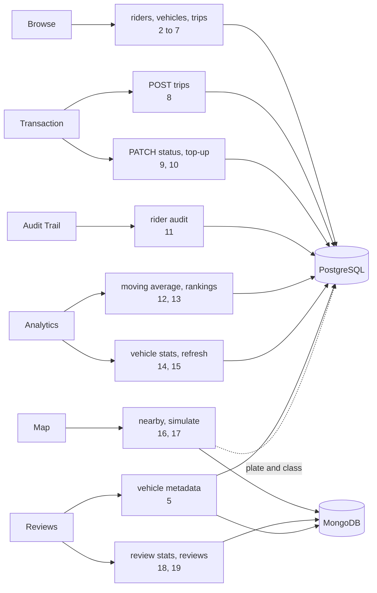

# API sketch: RideSync web app

Written for Assignment 2, Step 1, before any UI work. It lists the endpoints the six screens need, with inputs and outputs. It is independent of the server framework we pick.

The server stays thin. Each endpoint either runs a simple paged `SELECT`, or calls the Part A procedure, query, view or pipeline and returns the result as JSON.

## Endpoint list

| # | Method and path | Screen | Backed by |
| --- | --- | --- | --- |
| 1 | `GET /api/health` | all | ping to Postgres and Mongo |
| 2 | `GET /api/riders` | Browse, actor switcher | `riders` |
| 3 | `GET /api/riders/:id` | Browse, Transaction | `riders`, `trips` |
| 4 | `GET /api/vehicles` | Browse, Transaction | `vehicles` |
| 5 | `GET /api/vehicles/:id` | Browse, Reviews | `vehicles`, `mv_vehicle_trip_stats`, `VehicleMetadata` |
| 6 | `GET /api/trips` | Browse | `trips` |
| 7 | `GET /api/trips/:id` | Browse | `trips`, `TripReviews` |
| 8 | `POST /api/trips` | Transaction (Workflow 1) | `CALL book_trip(...)` |
| 9 | `PATCH /api/trips/:id/status` | Transaction | guarded `UPDATE trips` |
| 10 | `POST /api/riders/:id/wallet/topup` | Transaction | `UPDATE riders` (trigger logs `CREDIT`) |
| 11 | `GET /api/riders/:id/audit` | Audit Trail | `wallet_audit_logs` |
| 12 | `GET /api/analytics/moving-average` | Analytics (Workflow 2) | `sql/06_window_analytics.sql` |
| 13 | `GET /api/analytics/rankings` | Analytics (Workflow 2) | `sql/06_window_analytics.sql` |
| 14 | `GET /api/analytics/vehicle-stats` | Analytics | `mv_vehicle_trip_stats` |
| 15 | `POST /api/analytics/vehicle-stats/refresh` | Analytics | `refresh_vehicle_trip_stats()` |
| 16 | `GET /api/vehicles/nearby` | Map (Workflow 3) | `mongo/02_workflow3_geonear.js` |
| 17 | `POST /api/telemetry/simulate` | Map | inserts into `TelemetryPings` |
| 18 | `GET /api/reviews/stats` | Reviews (Workflow 4) | `mongo/03_workflow4_facet.js` |
| 19 | `GET /api/reviews` | Reviews | `TripReviews` |

## Browse

### 2. `GET /api/riders`

| Input | Notes |
| --- | --- |
| `search` | optional, matches part of the name, case-insensitive |
| `page`, `page_size` | default 1 and 20, `page_size` capped at 100 |

```json
{ "items": [ { "id": "6d5f...", "name": "Bradley Richardson", "wallet_balance": "6373.93", "has_active_trip": false } ],
  "page": 1, "page_size": 20, "total": 3000 }
```

The actor switcher in the page header uses this same endpoint with `search`.

### 3. `GET /api/riders/:id`

```json
{ "id": "6d5f...", "name": "Bradley Richardson", "wallet_balance": "6373.93",
  "active_trip": { "id": "7936...", "status": "REQUESTED", "fare_amount": "50.00", "vehicle_id": "9622...", "created_at": "..." },
  "trip_count": 17 }
```

`active_trip` is `null` when the rider has no `REQUESTED` or `IN_TRANSIT` trip. `404 RIDER_NOT_FOUND` if the id is unknown.

### 4. `GET /api/vehicles`

Inputs: `search` (part of the licence plate), `class` (`MINI`, `SEDAN`, `SUV`, `XL`), `is_active` (`true` or `false`), `page`, `page_size`.

```json
{ "items": [ { "id": "9d2e...", "license_plate": "VX 3714", "class": "XL", "is_active": true } ],
  "page": 1, "page_size": 20, "total": 500 }
```

### 5. `GET /api/vehicles/:id`

```json
{ "id": "9d2e...", "license_plate": "VX 3714", "class": "XL", "is_active": true,
  "stats": { "completed_trip_count": 87, "total_earnings": "24403.72" },
  "metadata": { "make": "Toyota", "model": "Innova", "year": 2023, "color": "white",
                "features": ["AC", "wifi"],
                "dynamic_features": { "fuel_type": "CNG", "seat_count": 7 },
                "inspections": [ { "inspected_at": "...", "passed": true, "inspector": "RTO Hyderabad", "notes": "ok" } ] } }
```

`stats` comes from the materialized view, so it can be stale. `metadata` is the `VehicleMetadata` document as stored. It is the flexible catalog document the Reviews screen has to display, so the server passes unknown keys through and the UI renders whatever is there. `metadata` is `null` if the vehicle has no document.

### 6. `GET /api/trips`

| Input | Notes |
| --- | --- |
| `status` | optional: `REQUESTED`, `IN_TRANSIT`, `COMPLETED` |
| `rider_id`, `vehicle_id` | optional filters |
| `from`, `to` | optional dates on `created_at` |
| `limit`, `cursor` | newest first, default 20, capped at 100 |

```json
{ "items": [ { "id": "7936...", "rider_id": "6d5f...", "rider_name": "Bradley Richardson",
               "vehicle_id": "9622...", "license_plate": "VX 3714",
               "fare_amount": "50.00", "status": "REQUESTED", "created_at": "..." } ],
  "next_cursor": "MjAyNi0xMC0xMlQxMToxMzoyOVp8NzkzNi4uLg==" }
```

`next_cursor` is `null` on the last page.

### 7. `GET /api/trips/:id`

The trip row as above, plus `"review": { "rating": 5, "tags": ["clean"], "comment": "...", "created_at": "..." }` from `TripReviews`, or `null`.

## Transaction (Workflow 1)

### 8. `POST /api/trips`: book a trip

Request:

```json
{ "rider_id": "6d5f...", "vehicle_id": "9622...", "fare_amount": "50.00" }
```

What the server does:

1. Runs `CALL book_trip(rider_id, vehicle_id, fare_amount, NULL)` on an **autocommit** connection. The procedure issues its own `COMMIT`, and we confirmed it fails with `invalid transaction termination` if the caller has a transaction open.
2. On success, reads the new trip, the rider's balance, and the rider's newest `wallet_audit_logs` row.

Success, `201`:

```json
{ "trip": { "id": "7936...", "status": "REQUESTED", "fare_amount": "50.00", "created_at": "..." },
  "balance_before": "6942.09",
  "balance_after": "6892.09",
  "audit_entry": { "id": "...", "action_type": "ESCROW", "amount_changed": "-50.00",
                   "balance_after": "6892.09", "timestamp": "..." } }
```

`balance_before` is `audit_entry.balance_after - audit_entry.amount_changed`, so both balances come from the row the trigger wrote. Returning `audit_entry` is what lets the UI show that the trigger fired.

Failure. Every case leaves no trip and no audit row. The response also carries `"balance": "<current balance>"` so the form can still show it.

| Database signal | HTTP | `code` | Message shown to the user |
| --- | --- | --- | --- |
| SQLSTATE `23514`, constraint `riders_wallet_balance_check` | 409 | `INSUFFICIENT_BALANCE` | "Not enough wallet balance. The fare is ₹X and the wallet has ₹Y. Top up and try again." |
| SQLSTATE `23505`, constraint `idx_active_rider_trip` | 409 | `ACTIVE_TRIP_EXISTS` | "This rider already has a trip in progress. Complete it before booking another." |
| SQLSTATE `RS001` | 422 | `INVALID_FARE` | "The fare must be greater than 0." |
| SQLSTATE `RS002` | 404 | `VEHICLE_NOT_FOUND` | "That vehicle does not exist." |
| SQLSTATE `RS003` | 409 | `VEHICLE_INACTIVE` | "That vehicle is no longer in the fleet. Pick another one." |
| SQLSTATE `RS004` | 404 | `RIDER_NOT_FOUND` | "That rider does not exist." |
| SQLSTATE `22P02` (bad UUID) or missing field | 400 | `BAD_REQUEST` | "Check the rider, vehicle and fare." |
| anything else | 500 | `INTERNAL` | "Something went wrong. Nothing was charged." |

The server matches on SQLSTATE and constraint name, never on message text.

### 9. `PATCH /api/trips/:id/status`: move a trip forward

Request: `{ "status": "IN_TRANSIT" }`

Allowed moves are `REQUESTED → IN_TRANSIT → COMPLETED`, one step at a time. The server runs `UPDATE trips SET status = $new WHERE id = $id AND status = $expected_previous`, so two people clicking at once cannot skip a step.

- `200` with the updated trip.
- `409 INVALID_TRANSITION` ("A COMPLETED trip cannot go back to IN_TRANSIT.") if the trip is not in the expected state.
- `404 TRIP_NOT_FOUND`.

This is how the demo shows the partial unique index: book a trip, try to book again (blocked), complete the trip, book again (allowed).

### 10. `POST /api/riders/:id/wallet/topup`

Request: `{ "amount": "500.00" }`. The server runs a plain `UPDATE riders SET wallet_balance = wallet_balance + $1`. The trigger writes the `CREDIT` row.

Response `200`: `{ "balance_before": "...", "balance_after": "...", "audit_entry": { ... } }`. `422 INVALID_AMOUNT` if the amount is not greater than 0.

This is not one of the four workflows. It is here so the insufficient-balance case can be fixed from the UI during a demo.

## Audit Trail

### 11. `GET /api/riders/:id/audit`

| Input | Notes |
| --- | --- |
| `from`, `to` | optional dates on `"timestamp"` |
| `limit`, `cursor` | newest first, default 50, capped at 200 |

```json
{ "rider": { "id": "6d5f...", "name": "Bradley Richardson", "wallet_balance": "6892.09" },
  "items": [ { "id": "...", "timestamp": "...", "action_type": "ESCROW",
               "amount_changed": "-50.00", "balance_after": "6892.09" } ],
  "next_cursor": null }
```

The running balance is `balance_after`, which the trigger recorded at the time of each change. The server does not recompute it. Read-only: there is no write endpoint for audit rows, and the database now rejects `UPDATE` and `DELETE` on the table.

## Analytics (Workflow 2 and the materialized view)

Endpoints 12 and 13 both run the Part A query in `sql/06_window_analytics.sql`. The CTEs and window functions stay as written, and the server only adds filters.

### 12. `GET /api/analytics/moving-average`: chart data

Inputs: `vehicle_id` (required), `from`, `to` (optional dates).

```json
{ "vehicle": { "id": "9d2e...", "license_plate": "VX 3714" },
  "series": [ { "trip_day": "2026-10-10", "daily_fare": "1693.54", "moving_avg_7day": "1211.30" } ] }
```

The `vehicle_id` filter goes inside the first CTE. The date filter goes on the final result, after the window is computed. If it went earlier, the first six days of the range would be averaged over missing data.

### 13. `GET /api/analytics/rankings`: ranked table

Inputs: `day` (optional date, defaults to the latest day with data), `limit` (default 20, capped at 100).

```json
{ "day": "2026-10-12",
  "items": [ { "revenue_rank": 1, "vehicle_id": "a77c...", "license_plate": "VX 3714", "class": "XL",
               "daily_fare": "1693.54", "moving_avg_7day": "1693.54" } ] }
```

`revenue_rank` is the query's `DENSE_RANK() OVER (PARTITION BY trip_day ORDER BY moving_avg_7day DESC)`. The inherited query ranks vehicles within each day by moving average, so the table is "top vehicles on a given day".

### 14. `GET /api/analytics/vehicle-stats`

Inputs: `sort` (`total_earnings` or `completed_trip_count`, default `total_earnings`), `page`, `page_size`.

```json
{ "summary": { "vehicles": 500, "completed_trips": 47254, "total_earnings": "15353110.08",
               "top_vehicle": { "license_plate": "555 ZUO", "total_earnings": "41175.16" } },
  "last_refreshed_at": "2026-10-12T11:13:32Z",
  "items": [ { "vehicle_id": "9d2e...", "license_plate": "555 ZUO", "class": "XL",
               "completed_trip_count": 121, "total_earnings": "41175.16" } ],
  "page": 1, "page_size": 20, "total": 500 }
```

Everything here is read from `mv_vehicle_trip_stats`.

### 15. `POST /api/analytics/vehicle-stats/refresh`

No body. Runs `SELECT refresh_vehicle_trip_stats()`. Response `200`: `{ "last_refreshed_at": "...", "duration_ms": 41 }`.

**Database change needed:** Part A stores no refresh time. We will add a one-row table that `refresh_vehicle_trip_stats()` updates, and read `last_refreshed_at` from it.

## Map (Workflow 3)

### 16. `GET /api/vehicles/nearby`

| Input | Notes |
| --- | --- |
| `lng`, `lat` | required, the origin the user picked on the map |
| `radius_m` | default 5000, capped at 5000 |
| `limit` | default 20, capped at 50 |

```json
{ "origin": { "lng": 78.4867, "lat": 17.385 }, "radius_m": 5000, "generated_at": "...",
  "results": [ { "vehicle_id": "361d...", "license_plate": "VX 3714", "class": "XL",
                 "distance_meters": 16.88, "location": { "lng": 78.486753, "lat": 17.385143 },
                 "pinged_at": "..." } ] }
```

This runs the Part A pipeline: `$geoNear` with `maxDistance`, `query: { is_available: true }` and `spherical: true`, then one row per vehicle with the nearest ping first. Two things change: the origin is a parameter, and `$limit` is `limit` instead of 1. Licence plate and class are looked up in Postgres by `vehicle_id`. `422 INVALID_ORIGIN` if the coordinates are missing or out of range. An empty `results` array is a normal answer.

The UI calls this every 5 seconds and redraws the markers and list, which meets "new pings appear without a full page reload".

### 17. `POST /api/telemetry/simulate`

Request: `{ "vehicles": 50 }` (optional, default 50). Inserts one fresh ping for that many random active vehicles, each a short step from its last position. Response `201`: `{ "inserted": 50 }`.

It is needed for two reasons. Seeded pings expire after 2 hours (TTL index), so without it the map is empty in a demo. And it gives the polling something new to show.

## Reviews (Workflow 4)

### 18. `GET /api/reviews/stats`

Input: `vehicle_id` (optional; fleet-wide when absent).

```json
{ "scope": { "vehicle_id": null },
  "rating_distribution": [ { "rating": 1, "count": 541 }, { "rating": 2, "count": 844 },
                           { "rating": 3, "count": 2925 }, { "rating": 4, "count": 10048 }, { "rating": 5, "count": 13994 } ],
  "top_tags": [ { "tag": "late", "count": 8229 } ],
  "average_rating": 4.27, "review_count": 28352 }
```

One call to the Part A `$facet` pipeline. The server flattens the three facet arrays into this shape, and fills in ratings with no reviews as `count: 0` so the chart always has five bars. With no reviews, `average_rating` is `null` and `review_count` is 0.

### 19. `GET /api/reviews`

Inputs: `vehicle_id` (optional), `page`, `page_size`. Returns `{ items: [ { trip_id, rider_id, vehicle_id, rating, tags, comment, created_at } ], page, page_size, total }`, newest first.

## Which screen calls what



## Database work this sketch depends on

Already done in Step 1 (see `handover_note.md`): the indexes behind endpoints 3, 6, 11, 12 and 18, the SQLSTATEs behind endpoint 8, and the append-only audit table.

Still to do when the endpoints are built:

| Endpoint | Needs |
| --- | --- |
| 14, 15 | A stored "last refreshed" time for the materialized view |
| 11 | Seeded audit rows spread over past dates, so the date filter has something to filter |
| 16, 17 | A ping simulator, and seeded pings that follow a path per vehicle instead of random points |
